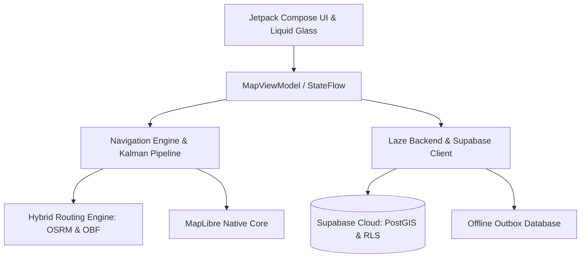

<div align="center">

# Laze (لايز)

**تطبيق الملاحة المجتمعي الذكي والحديث للعراق والشرق الأوسط**
**Smart Community Navigation & Real-time Road Intelligence**

[](LICENSE)
[](https://android.com)
[](https://github.com/MMUU6699/Laze/releases)
[](https://github.com/MMUU6699/Laze)

---

[نظرة عامة](#نظرة-عامة) • [المميزات الرئيسية](#المميزات-الرئيسية) • [الهندسة المعمارية وطريقة الصنع](#الهندسة-المعمارية-وطريقة-صنع-التطبيق) • [الواجهة والتصميم](#الواجهة-والتصميم) • [الخصوصية والأمان](#الخصوصية-والأمان) • [البناء والتشغيل](#طريقة-البناء-والتشغيل) • [English Overview](#english-overview)

</div>

---

## نظرة عامة

**Laze (لايز)** هو تطبيق ملاحة ذكي، مفتوح المصدر، ومصمم خصيصاً ليتناسب مع واقع الطرق وحركة المرور في العراق ومنطقة الشرق الأوسط. يقدم Laze بديلاً متكاملاً وقوياً لتطبيقات الملاحة التجارية، بالاعتماد على بيانات الخرائط الحرة المفتوحة ومشاركة المجتمع المباشرة، مع التركيز الصارم على الخصوصية، السرعة، والعمل دون اتصال بالإنترنت.

---

## المميزات الرئيسية

### 1. إرشاد ملاحي متقدم (Turn-by-Turn Navigation)
- **توجيه لحظي دقيق**: مسارات تفصيلية خطوة بخطوة مع مؤشرات المسارات المناسبة (Lane Guidance) ومخارج الطرق السريعة (Highway Shields).
- **مؤشر موقع فائق السلاسة (Kalman Filter Puck)**: حركة ديناميكية انسيابية لمؤشر الموقع وسهم الاتجاه مع التنبؤ الحركي الذكي لإزالة التقطيع والاهتزاز الناتج عن إشارات GPS.
- **تنبيهات السرعة الزائدة**: عداد سرعة متكيف وذكي ينبه السائق عند تجاوز السرعة المحددة للطريق.

### 2. بلاغات مجتمعية حية (Crowdsourced Road Intelligence)
- **نظام بلاغات فوري بنقرتين**: واجهة سريعة وبديهية للإبلاغ عن السيطرات الأمنية، الحوادث المرورية، المطبات، الحفر، الفيضانات، وتراكم المياه، وإغلاقات الطرق.
- **صندوق صادر محلي (Offline Outbox)**: إمكانية تسجيل البلاغات حتى في حال انقطاع تغطية الإنترنت بالكامل، وحفظها محلياً ليتم رفعها تلقائياً فور عودة الاتصال مع نظام انتهاء صلاحية ذكي (TTL).
- **تصويت وتأكيد مجتمعي**: إمكانية تأكيد البلاغات أو نفيها من قبل السائقين الآخرين لضمان دقة ونقاء البيانات.

### 3. توجيه صوتي عربي نقي (Arabic Voice Engine)
- **محرك صوتي متطور**: إرشادات صوتية طبيعية باللغة العربية مع خفض صوت الوسائط مؤقتاً (Audio Ducking) لضمان وضوح التعليمات.
- **فحص سلامة المحرك الصوتي (`VoiceHealth`)**: نظام تشخيص ومراقبة تلقائي لحالة محرك النطق في نظام أندرويد لضمان عدم تفويت أي توجيه صوتي أثناء القيادة.

### 4. خرائط حرة ومفتوحة بدون تتبع
- **محرك MapLibre Native**: عرض متجهات الخرائط ثلاثية الأبعاد (Vector Tiles) بسرعة فائقة واستهلاك بطارية منخفض جداً عبر معالجات الرسوميات OpenGL ES.
- **خرائط OpenFreeMap و OpenStreetMap**: بيانات خرائط حرة ومحدثة عالمياً مع دعم التنزيل المسبق للاستخدام بدون إنترنت (Offline Vector & Routing Packages).
- **طبقات متعددة**: دعم صور الأقمار الصناعية، المعالم ثلاثية الأبعاد، ونقاط الاهتمام (POIs).

---

## الهندسة المعمارية وطريقة صنع التطبيق

صُمم تطبيق **Laze** وفق أعلى معايير هندسة البرمجيات الحديثة لنظام أندرويد، بالاعتماد على معمارية الطبقات المنفصلة (Clean Architecture) ونمط **MVI/MVVM**:



### هيكل الحزم البرمجية (Multi-Module Project)
1. **`:app` (طبقة التطبيق والواجهات)**:
   - مبنية بالكامل باستخدام **Jetpack Compose**.
   - إدارة الحالة عبر نماذج العرض (`MapViewModel`, `SearchViewModel`) وتدفقات البيانات التفاعلية (`StateFlow`).
   - حقن التبعيات الشامل عبر **Dagger Hilt**.
   - محرك الرسوميات وتخصيص الخريطة عبر طبقة مخصصة تجمع بين رندرينج MapLibre Native ومؤثرات Compose.

2. **`:core` (طبقة المحرك والبيانات)**:
   - خوارزميات الملاحة، تصفية الضوضاء لنظام الملاحة عبر مرشح كالمان (`Kalman Filter`).
   - نظام مطابقة المسار على شبكة الشوارع (Map-Matching).
   - محرك الصوت والتوجيه العربي ومولد العبارات الذكي.
   - عميل الاتصال السحابي بالسيرفر (`LazeBackendConfig`, `SupabaseManager`) المتصل بقواعد بيانات **Supabase** و **PostGIS**.
   - إدارة قواعد البيانات المحلية عبر SQLite مع التشفير.

3. **`:osmand-shaded` (محرك المسارات المحلي)**:
   - فك تشفير حزم الطرق والمسارات المضغوطة لتوليد المسارات بدون اتصال بالإنترنت في ثوانٍ معدودة.

---

## الواجهة والتصميم

### شريط البحث الزجاجي السائل (Liquid Glass SearchBar)
يتميز Laze بتصميم عصري وفريد لواجهة المستخدم:
- **تأثير الزجاج الشفاف (Liquid Glass)**: تدرج لوني شبه شفاف مع حواف ناعمة وانعكاسات ضوئية خفيفة تعطي شعوراً بالحداثة والأناقة فوق الخريطة.
- **تخطيط متجاوب ومتكامل مع اللغة العربية (RTL)**: دعم كامل وشامل لاتجاه الكتابة من اليمين إلى اليسار دون أي تشويه في الرموز أو الإزاحات.
- **بحث فوري وتلقائي**: اقتراحات بحث سريعة للأماكن، الشوارع، والمحطات مع إمكانية التحديد المباشر لنقاط الانطلاق والوصول.

---

## الخصوصية والأمان

الخصوصية في Laze ليست ميزة إضافية، بل هي الأساس الذي بني عليه التطبيق:
- **بدون أي مكتبات تتبع (Zero Telemetry)**: لا يحتوي التطبيق على أي مكتبات تجسس، إعلانات، أو متتبعات تابعة لجهات خارجية.
- **استقلالية تامة عن خدمات Google**: يعمل التطبيق بكفاءة 100% على كافة أجهزة أندرويد المعدلة والرومات المفتوحة (مثل GrapheneOS و LineageOS) بدون الحاجة إلى Google Play Services.
- **حماية الهوية في السحابة**: تعتمد قاعدة بيانات Supabase سياسات صارمة لحماية مستوى الصفوف (**Row Level Security - RLS**)، بحيث لا يتم ربط البلاغات والتقارير المرورية بهوية المستخدم الشخصية أو موقعه الدائم.

---

## البنية السحابية وقاعدة البيانات (Supabase Backend)

يعتمد Laze على منصة **Supabase** لتوفير بنية سحابية موزعة وفورية:
- **امتداد PostGIS**: لمعالجة الإحداثيات الجغرافية وحساب البلاغات القريبة من مسار السائق بدقة زمنية وجغرافية فائقة.
- **Realtime Channels**: إرسال وتلقي التحذيرات المرورية والحوادث اللحظية فور وقوعها لجميع السائقين في المنطقة.
- **الإعدادات المركزية الآمنة (App Remote Config)**: توزيع مفاتيح الخدمات والخرائط وتحديثها سحابياً دون الحاجة لتحديث التطبيق.

---

## طريقة البناء والتشغيل

### المتطلبات الأساسية
- **Android Studio** (Ladybug أو أحدث) أو بيئة سطر الأوامر.
- **Java Development Kit (JDK)**: الإصدار 21.
- **Android SDK**: Android 15 (API 35/37).

### خطوات البناء
1. **استنساخ المستودع**:
   ```bash
   git clone https://github.com/MMUU6699/Laze.git
   cd Laze
   ```

2. **تهيئة ملف الإعدادات المحلية (`local.properties`)**:
   أضف مسار الـ SDK وبيانات السحابة الخاصة بك:
   ```properties
   sdk.dir=C\:\\Users\\Username\\AppData\\Local\\Android\\Sdk
   
   # إعدادات Supabase السحابية (اختياري، يمتلك التطبيق استجابة محلية تلقائية)
   supabase.url=https://YOUR_PROJECT.supabase.co
   supabase.anon_key=YOUR_SUPABASE_ANON_KEY
   
   # مفاتيح الخرائط الاختيارية
   mapbox.token=YOUR_MAPBOX_TOKEN
   ```

3. **بناء نسخة الاختبار (Debug APK)**:
   ```bash
   ./gradlew :app:assembleDebug
   ```

4. **بناء النسخة النهائية الجاهزة للإطلاق (Release APK)**:
   ```bash
   ./gradlew :app:assembleRelease
   ```
   ستجد ملف الـ APK النهائي في المسار:
   `app/build/outputs/apk/release/app-release.apk`

---

## English Overview

**Laze** is an open-source, community-driven, smart navigation application designed for Iraq and the Middle East:
- **Turn-by-Turn GPS Navigation**: Real-time voice-guided routing with lane assist and highway exit indicators.
- **Ultra-Smooth Location Puck**: Motion-interpolated Kalman filter pipeline eliminating GPS jitter.
- **Crowdsourced Traffic & Hazard Reporting**: Instant 2-tap reporting of security checkpoints, accidents, speed cameras, potholes, and road closures.
- **Offline-First Resilience**: Local outbox queue with automatic cloud sync upon network restoration.
- **Liquid Glass Interface**: High-end frosted glass aesthetic with complete native RTL Arabic support.
- **Zero Telemetry & Google-Free**: Complete privacy without Google Play Services or tracking frameworks.

---

## الترخيص والحقوق (License)

تطبيق **Laze** برنامج حر مفتوح المصدر مرخص بموجب رخصة **GNU General Public License v3.0**. يمكنك استخدامه، دراسته، وتطويره بحرية تامة مع الحفاظ على فتح المصدر لأي تعديلات مستقبلية.
